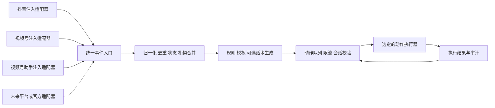

# 智能场控架构与当前版本范围

状态：按用户确认的统一脚本注入方案确定设计，尚未实现。协议、算法、集成和阶段验收见 [详细设计 v1](smart-moderation-detailed-design.md)。
日期：2026-10-12。

## 当前版本

| 平台 | 接入方式 | 执行范围 |
| --- | --- | --- |
| 抖音 | 页面脚本注入 | 采集已验证的直播互动事件，执行当前账号允许的文字发送 |
| 视频号 | 页面脚本注入 | 浏览器页面与微信客户端分别验证、适配 |
| 视频号 | 官方助手页面脚本注入 | 通过注入脚本观察消息及操作实际发言控件；不标为官方开放 API |

主播和助播两种账号角色共用以上接入路径，不按角色硬编码为“主播用官方、助播用注入”。官方 API/SDK 和其他平台作为未来适配器扩展点，本版本不依赖相关准入或实现。

业务目标包括礼物感谢、观众欢迎、粉丝团升级祝贺及荣誉/财富等级变化提醒。具体能力以账号、房间、客户端和适配器的验证结果为准；平台之间的等级含义分别建模，缺失事件不通过猜测补齐。

UI 开发继续暂停。首阶段使用 CLI、TOML 配置和日志完成探针、回放及运行控制。现有录像核心保留独立生命周期。

## 分层和依赖方向



核心只依赖统一事件、动作和适配器契约，不依赖 DOM、浏览器驱动、微信内部对象或平台私有字段。平台解析逻辑、选择器、注入时机和自动化控件操作全部位于适配器中。

注入装载器、采集来源和动作执行器独立选择。例如，视频号直播页脚本采集，再由助手页脚本发送。组合必须显式配置，并校验两个端属于同一平台、目标房间、直播场次和许可账号。当前版本复用既有同源资源注入与代理运行经验，不引入 Playwright；网络消息优先探测，DOM 作为补充。

## 领域标识与配置维度

场控模块使用可注册、可验证的 `platform_id` 字符串，例如 `douyin`、`wechat_channels`。新增平台通过注册适配器及事件映射接入，不要求修改核心规则引擎中的平台枚举或分支。现有录像的 `Platform` 枚举本阶段保留，必要时由集成层做转换，不提前重构录像模块。

配置维度包括：

- `role`：主播或助播，描述实际账号身份，不决定传输方式。
- `platform_id`、`account_id`、`room_id`：平台、账号及平台内房间标识；账号标识不包含凭据。
- `live_session_id`：实际直播场次标识；不能把断线重连直接当作一场新直播。
- `connection_id`、`session_epoch`：连接标识和控制会话代次；换房、登录变化、重新授权时使旧指令失效。
- `event_source_id`、`action_executor_id`：采集端与执行端，可来自不同适配器。

房间身份无法可靠匹配时禁止自动执行。相同用户昵称不能作为用户主键；不同平台的用户 ID 不直接合并。角色由实际登录身份及允许操作验证，不仅信任配置中的声明。

## 模块契约

以下是后续实现的职责契约，不是已经提供的 Rust API。

| 契约 | 职责 |
| --- | --- |
| `AdapterRegistry` | 注册和选择平台适配器，检查协议版本及环境要求 |
| `EventSource` | 连接、报告能力、输出事件和健康状态；断线及事件缺口显式上报 |
| `ActionExecutor` | 验证目标身份，执行有限动作，报告执行结果；不接受任意 JS 或系统命令 |
| `Transport` | 注入端双向通信或本地进程间通信；与业务事件语义分离 |
| `ModerationEngine` | 维护用户状态，去重和合并事件，匹配规则，生成动作 |
| `ActionScheduler` | 有界队列、过期检查、优先级、账号及房间限流、停止控制 |
| `EventJournal` | 记录脱敏事件、决策原因和动作结果，提供离线回放 |

当前仅计划实现有限的 `send_chat` 动作。未来的置顶、禁言、语音等操作通过单独动作类型与能力声明扩展，不自动获得执行权限。

## 事件与动作协议

事件信封包含协议版本、平台/房间/场次、来源、事件 ID、平台发生时间、观察时间、用户标识、事件类型和类型化负载。负载可保留有界的平台扩展字段，但核心规则不直接访问它们。

统一事件类型至少区分礼物、入场、关注、评论、粉丝团加入、粉丝团升级和等级快照。由快照推断的等级变化携带推断标记及旧值/新值，不伪装成平台原生升级事件。首次观察等级只建立基线。

礼物数量必须附带语义：本次增量、累计连击或未知；不同来源按适配器文档归一化，不能把所有来源都按累计或增量处理。未知语义时可以生成不带数量的感谢，不能进行错误累计。

礼物感谢按用户独立等待：每次确认有新的送礼就从该时刻重新等待 5s，持续送礼不设最长等待时间；静默满 5s 后合并这一批礼物感谢。不同礼物名称拼接超过 30 字时使用“感谢礼物飘屏”，30 字门槛不包含昵称、数量和固定文案。连击去重、排队中再次送礼、用户窗口与动作 TTL 的具体约定见详细设计。

动作包含动作 ID、关联事件、目标执行器、房间/场次、控制会话代次、类型、文字和过期时间。控制端入队与执行端发送前均校验目标和有效期。

执行结果区分 `accepted`、`submitted`、`confirmed`、`failed`、`unknown`：收到指令、操作控件、提交平台、平台确认不是同一件事。每种适配器明确确认依据。平台缺少幂等发送能力时不承诺严格一次发送；`unknown` 不自动重发，避免重复发言。

## 能力协商和多端协调

能力清单分别报告礼物事件、入场事件、粉丝团升级、等级快照、文字发送和发送确认，并附验证状态、覆盖范围及限制。未获准或未验证的能力保持禁用；DOM 通知列表不默认视为全量事件。

同一房间可以有多个采集来源，但每个动作类型只允许一个持有有效执行租约的执行器。旧连接断开不能清除新连接的注册。多个来源缺少共同平台事件 ID 时无法保证跨来源准确去重，此时为相应事件类型指定主采集源，备用源仅用于诊断或显式切换。

连接身份由本地配对和许可配置建立。回环监听不作为身份凭证；注入来源、消息大小、队列容量、房间范围和预定义动作必须限制。页面中的评论和昵称仅作为输入数据，不作为控制命令。

## 扩展和现有项目的集成

建议后续目录边界：

```text
src/moderation/                 # 协议、规则、状态、调度、审计
src/moderation/adapters/        # Rust 侧注册和各平台映射
assets/moderation/douyin/       # 抖音注入采集与执行
assets/moderation/wechat/       # 视频号注入采集与执行
tests/moderation/               # 脱敏夹具与行为回放
```

目录为设计建议，本轮没有创建上述实现。助手、直播页和微信客户端使用分别适配的注入脚本，共用 SDK 和控制协议。详细目录、运行时租约和同源传输见详细设计。

现有 `ChannelsBridge` 单连接、无界队列等实现不直接扩展为场控控制服务；新模块必须按连接、房间和请求管理，并清理超时请求。已有注入和录像资源继续服务现有功能，场控脚本使用独立命名空间，避免相互覆盖。

添加未来平台的流程是：注册平台 ID → 实现事件来源/动作执行器 → 声明能力 → 添加事件映射与回放样本 → 验证执行结果。核心模板、规则、调度和日志可复用。新增未支持的事件类型应明确忽略或记录，不导致整个流断开。

## 交付顺序和验收门槛

1. 三条当前接入路线做能力探针；视频号浏览器与微信客户端分别验证。采集测试与真实发言测试分开，真实发言使用明确授权的账号和直播间。
2. 实现统一协议及脱敏事件回放，验证重复/乱序、礼物计数、升级基线和规则动作。
3. 接通单房间文字发送，加入限流、执行租约、会话代次、过期动作和停止控制。
4. 扩展到所有已通过探针的当前路线，并验证混合采集/执行。

发布前必须满足：不跨房或跨账号发送，重连不重放过期动作，多端不重复执行，礼物计数不误算，等级首次出现不误报升级，发送不确定状态可追踪，停止后不再派发新动作，录像仍可独立运行。

各平台具体事件覆盖与客户端支持仍需实测。当前范围不承诺纯官方场控、所有入场事件、每次荣誉升级或任意微信版本兼容。

开源项目、关键源码和许可证筛选见 [开源参考调研](open-source-references.md)。参考项目不替代上述能力探针和验收门槛。
