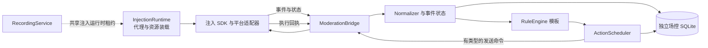

# 智能场控详细设计 v1

日期：2026-10-12。状态：设计稿，部分实现，实际进度见第 12 节。依据：用户已确定复用现有脚本注入方案，Rust 控制端分析并调度，UI 暂停。本文替代早期设计中独立浏览器自动化驱动的建议；官方助手也是注入目标页面，不引入 Playwright。

## 1. 目标与范围

首版支持自动文字欢迎、礼物感谢、粉丝团升级祝贺和荣誉/财富等级变化提醒。最后两类只有在对应来源验证后启用；没有数据时报告能力不足，不拼造升级事件。模板为默认方式，AI 话术放在后续阶段。录像可以独立启动、继续和停止。

| 适配器 ID | 注入目标 | 账号角色 | 首版验证重点 |
| --- | --- | --- | --- |
| `douyin.live_page` | 抖音直播网页 | 主播/助播，按实际身份验证 | 页面网络消息、DOM 补充、发言控件 |
| `wechat.live_page` | 视频号浏览器直播页 | 同上 | 页面消息、直播标识、发言入口 |
| `wechat.desktop_live` | 微信客户端的可注入直播渲染页面 | 同上 | 注入是否成功、渲染上下文、是否允许发言 |
| `wechat.assistant_page` | 视频号官方助手网页 | 有对应助手权限的账号 | HTTP 消息响应、iframe、输入发送 |

这些是目标环境，不是已确认的能力清单。微信客户端渲染进程、版本或证书策略无法支持时标为 unsupported，不绕过证书固定、不改客户端二进制。抖音商家中控、其他平台和官方 API 留作未来适配器。

注入机制和采集手段分别建模：同一套注入装载器可以加载 DOM 来源或网络来源。油猴可作为浏览器注入的可选装载器；首版主路线复用已有 mitmproxy 同源资源注入。不要为复用油猴而建立第二套规则核心。

## 2. 总体结构



Rust 拥有规则和发送队列；脚本只拥有页面观察、执行前检查和单条执行状态。所有平台事件经过适配器翻译，再进入统一规则。脚本不运行 AI、不持久化业务规则、不自行自动感谢，不接收任意 JS 表达式。

采集源和执行端可以不同，但必须经过同房间映射校验。首个里程碑固定单来源/单执行端，后续再启用混合组合。多个来源没有共同事件 ID 时按事件类型指定主源，不用昵称和时间窗口宣称准确跨源去重。

## 3. 与当前代码的集成

| 现有位置 | 已有能力 | 设计中的处理 |
| --- | --- | --- |
| `src/capture_sidecar.rs` | 生成 mitmdump addon，响应注入、同源转发 | 提取通用装载与路由层；原录像 addon 行为保留 |
| `src/wechat_inject.rs` | 静态资源表、加载顺序、录像页面状态 | 作为装载参考，新增独立场控资源注册表 |
| `src/wechat_runtime.rs` / `wechat_proxy.rs` | 代理启动回滚、停止恢复、证书与明确 consent | 增加单进程共享租约，禁止两个进程各自覆盖代理 |
| `src/wechat_bridge.rs` | 请求 ID 和页面 API 回传 | 保持服务录像；新增场控桥接，补齐连接身份、有界队列和清理 |
| `src/service.rs` / `recorder.rs` | 录像生命周期 | 不依赖场控，场控故障不得停止 FFmpeg |
| `src/store.rs` | 录像任务数据库 | 不塞入场控字段；场控单独数据库和迁移 |
| `src/main.rs` | CLI | 新增 moderation 子命令，无 GUI 改动 |

先实现独立场控桥接和只读探针，再提取共享装载器；不能为了抽象一次性改写已修好的录制链路。现有上游录像资源保持原命名空间，新增资源使用 `/__live_archive/moderation/v1/assets/` 和 `window.__liveArchiveModerationV1`。

现有 capture permit 仅涵盖录像元数据，不复用它授权互动数据。新增独立 `ModerationPermit`，限定环境、账号配置、房间、能力和有效期。代理/CA 继续遵循现有显式 consent 接口；设计工作本轮不改变系统设置。

建议目录（设计目录，不代表已创建）：

```text
src/injection/                # 后续提取 loader、route、runtime、proxy lease
src/moderation/
  protocol.rs  registry.rs  bridge.rs  session.rs
  normalize.rs  dedupe.rs  gifts.rs  levels.rs
  rules.rs  templates.rs  scheduler.rs  executor.rs
  journal.rs  replay.rs  config.rs  service.rs
  adapters/douyin.rs  adapters/wechat.rs
assets/moderation/
  sdk/bootstrap.js  transport.js  hooks.js  lifecycle.js
  adapters/douyin-live.js
  adapters/wechat-live.js  wechat-desktop.js  wechat-assistant.js
tests/moderation/fixtures/
```

JS 使用可读模块源码和本地固定资源，首版不引入远程运行时依赖。打包和平台协议解码依赖在探针结果明确后选型；所有 bundle 可追溯版本/hash。核心 platform_id 使用注册字符串，不改已有录像 Platform 枚举。

## 4. 注入和页面生命周期

1. 控制端读取配置并启动只读模式，注册允许的页面/房间，申请注入运行时租约。
2. 代理仅匹配允许 host、文档路径及必要资源路径，在平台业务 JS 前加载同源 bootstrap。不修改媒体内容，不解码加密媒体。
3. bootstrap 同步安装轻量观察 hook，再异步加载适配器；CSP、加载顺序和 iframe 进入探针输出。不能为了场控全局移除 CSP 或关闭浏览器保护。
4. SDK 建立 document_id、page_instance_id、page_generation。观察到身份/房间变化，立即取消执行资格并请求重新绑定。
5. 控制端验证身份、场次、环境能力后返回 binding；只有 execute 模式且绑定有效才授予发送租约。
6. 页面关闭/切房/登出或控制端超时，脚本停发；重连仅恢复观察，新绑定成功后才可恢复执行。

同一文档重复注入是幂等的；不同文档/iframe 实例不能靠全局变量假装同一个连接。父文档负责确定目标 frame，frame 必须通过自己的握手。跨源 iframe 按其真实 origin 单独授权，不盲目注入全部 frame。

fetch hook 必须保留调用 this、Request、返回 Promise 和响应正文消费语义，只 clone 匹配响应；XHR 在匹配 URL 的 load 时读取允许类型。解码在独立有界任务中执行，不阻塞页面业务。已有 WebSocket 的消息监听不改平台消息/ACK；构造器包装要保留原 prototype 和静态常量，排除本地桥接连接。不劫持全站所有网络响应递归解析。

网络来源优先，DOM 来源只报告实际可见内容。注入晚于连接创建时不能谎报网络覆盖；允许用户正常刷新页面后重新探测。DOM 节点替换时重新定位并解绑旧 observer，所有计时器、hook 和监听器由 dispose 管理。恢复 hook 前确认当前包装仍属于本实例，避免覆盖录像或其他脚本的新包装。

## 5. 通信与绑定协议

### 5.1 主传输

复用同源 HTTP 路由，避免 HTTPS 页面直接访问本地 HTTP/WS 的 CSP 与浏览器差异。路径位于 `/__live_archive/moderation/v1/`：

| 路径 | 用途 |
| --- | --- |
| `POST hello` | 一次性配对，声明页面及能力 |
| `POST events` | 有序批量事件，返回接收序号 |
| `POST poll` | 携带心跳/绑定摘要，取命令及租约状态 |
| `POST results` | 执行阶段回执 |
| `POST goodbye` | 尽力解绑，正确性不依赖 unload 回调 |

proxy 路由仅转发到固定 Rust 回环端点，不接受页面提供的任意目标地址。禁止将本地协议请求发往平台源站；本地服务不可用返回明确 503。首版 poll 每 500ms，单请求上限 2s、每实例仅一个在途请求，空响应立即释放；代理转发使用异步 I/O，不能用同步长轮询阻塞整个 mitmproxy 事件循环。错误退避 1/2/4/8s，上限 10s；活动期间心跳失效 3s 停发。

Transport 保留 WS 实现接口，但首版不要求同源 WSS 转发。油猴装载器未来可通过 GM 请求映射到相同协议，不改变业务信封。

### 5.2 配对与身份

代理在允许文档的 bootstrap 中写入 60s 有效的一次性随机配对凭据，Rust 端存储其摘要和预期 scope。hello 消耗凭据后获得短期连接 token，后续携带 Authorization，禁止 token 放 URL、日志或数据库。重连重新建立握手，旧 token 和命令失效。token 实现使用密码学随机源，不能用昵称、时间或 room_id 生成。

来自网页的 token 可被同页脚本读取，它证明许可页面通道而非登录账号真实性；威胁模型不承诺抵抗被攻陷的目标页面。账号和房间需要结合平台页面可核验标识、用户本地预设及服务端绑定校验。Origin/Host 白名单是附加检查，不把“来自回环”当认证。CSRF、重放、连接上限和 token 到期都要测试。

### 5.3 标识约定

- `platform_id`：如 `douyin`、`wechat_channels`。
- `room_key`：平台内稳定规范房间 ID；web_rid、内部 webcast room_id、视频号 object/live 标识存为适配器 aliases，不能混用。
- `account_key`：配置中的本地账号名；`actor_id`：页面验证的实际发言账号 ID。
- `live_session_id`：平台场次 ID；缺失时控制端创建 provisional 标识并标记推定，同一短重连保留，不能证明同场时停发等待重新绑定。
- `binding_id`、`session_epoch`：控制端签发；换房/换号/重新授权/执行状态重置时提升代次。
- `connection_id`：控制端每次连接签发；`document_id` / `page_generation`：页面文档及导航代次；旧连接不得清理新连接。

hello 包含协议版本、SDK/适配器版本、environment、页面 origin/path（无敏感 query）、identity evidence 和 capability proposal。hello_ack 返回以上 binding、模式、限额和 token。大版本不兼容拒绝绑定，小版本未知可选字段忽略，未知命令拒绝而非 eval。

### 5.4 事件信封示例

以下均是拟定的协议 v1，不是现有接口。所有平台 64 位 ID 用字符串。

```json
{
  "v": 1,
  "kind": "event_batch",
  "connection_id": "conn-a",
  "binding_id": "binding-a",
  "session_epoch": 4,
  "first_seq": 101,
  "events": [{
    "seq": 101,
    "event_id": "local-a",
    "native_event_id": "platform-msg-1",
    "event_type": "gift.observed",
    "observed_at": "2026-10-12T08:00:00Z",
    "occurred_at": null,
    "source": {"id": "source-a", "kind": "network", "coverage": "observed"},
    "user": {"id": "user-1", "nickname": "观众", "identity_quality": "platform_id"},
    "payload": {
      "gift_id": "gift-1", "name": "礼物",
      "quantity": 3, "quantity_mode": "cumulative",
      "combo_id": "combo-1", "combo_end": false
    }
  }]
}
```

平台/房间/账号/场次以服务端 binding 为准，消息内即便重复声明也必须一致。server 先验证再持久化；成功提交后返回 `acked_seq`。JS 缓存未确认事件，重连重发需要原 event_id 不变，旧代次数据只能进入诊断回放，不能触发当前发送。

默认每 batch 最多 50 条/64KiB，总请求 128KiB；每文档缓存 500 条/2MiB。超载先丢弃可合并统计，再丢过期欢迎，礼物/升级无法保留时发 gap 并暂停对应规则。序号缺口、重复 batch 和服务拒收须显式处理；不宣称无损。未知消息只记录方法名/有界摘要，不上传完整响应或凭据。

### 5.5 能力声明

每项能力包含 `unsupported | observed | verified`、source、identity_quality、coverage、版本和限制。执行端声明 `send_chat`、`confirmation=none|response|echo`、文本约束、frame 信息。脚本只提出能力，控制端保留验证记录和启用配置。版本变化或关键选择器失效会撤销 verified 状态，不因页面包含一个按钮就授予发送。

## 6. 事件语义和状态算法

统一事件：`chat.received`、`member.entered`、`follow.created`、`gift.observed`、`fansclub.joined`、`fansclub.upgraded`、`level.snapshot`、`room.started/ended`；gap、身份变化和能力变化属于控制状态。平台扩展类型可注册；不识别的类型不触发规则。

主去重键为 `(platform, room, live_session, source_namespace, native_event_id)`；native ID 没有共同命名空间时不能跨源合并。DOM 只能获得有限指纹时标为 heuristic，本地用文档实例、节点代次及内容抑制重复，保留漏报/误合并风险。相同昵称不合并用户；无可靠身份的 DOM 来源默认不能触发等级差分。

### 礼物合并

组合键至少包含场次、发送者 ID、接收者 ID（若有）、gift_id、combo_id。昵称不参与主键。累计数据按组维护最大计数：`delta=max(0, current-max_seen)`；重复/乱序不累计，结束包不再次加总。增量数据先按消息 ID 去重再加总，二者绝不能混算。

连击归一化与感谢聚合是两层：前者得到真实新增送礼，后者以用户为单位合并这些新增礼物。已结束连击组保留 10min tombstone，重复结束包不重复感谢；未知计数语义保留名称但不编造数量。金额必须说明单位和单价/总价语义，首版不做货币换算。

**感谢按用户做 5s 滑动静默等待，不设最长等待时间。** 感谢窗口键为 `(platform,room,live_session,sender_user_id,recipient_scope)`；recipient_scope 区分当前感谢目标，避免连麦礼物算到错误接收者。不同用户的计时器和礼物列表完全独立，同一用户不同场次/房间也分开。只有确认是新的送礼才重置等待，重复消息、累计值未增加和无新增的结束包不延期。账号无可靠用户 ID 时不能以昵称冒充精确用户维度，保持对应自动感谢禁用并报告原因。

每个用户窗口包含 `batch_id`、`revision`、`last_gift_at`、`due_at`、`items` 和归属事件 ID。每次有效新增送礼合并 items（按 gift_id 同类累加、不同礼物保留首次出现顺序），并设置 `due_at=控制端接收单调时间+5000ms`。同一连击结束不提前感谢。持续送礼 1min 或更久也持续延期，不按 5s 强制分段；正常聚合等待不消耗动作 TTL。

实现使用带 revision 的 deadline 队列，旧计时任务醒来发现 revision 不符则忽略，避免新礼物到达与旧定时回调竞态。静默满 5s 时生成内部 `gift.batch_ready`，携带 gift_items、关联事件、用户和 batch revision，再生成一条感谢动作。只有临近截止点到达的送礼与定时事件竞争时，单房间事件循环先处理已入队且时间不晚于 deadline 的送礼，再处理到期任务。

若感谢已在控制端队列等待限流、尚未进入 dispatching，此用户又送礼：原动作 cancelled（reason=new_gift），重新打开原 batch、合并已有和新增礼物，再等待 5s。从 dispatching 起窗口冻结，新礼物进入下一 batch；已经交给页面的文案不撤回重写。batch→action 转移与取消在同一房间状态机及数据库事务中完成。已终态的 suppressed/expired/unknown 窗口不偷偷补发，新增礼物创建新 batch 并保留此前审计。

内存限制不能通过强制提前感谢来改变这项规则。单房间同时活动用户上限先设 500、每窗口不同 gift_id 上限 100；超出时落日志、标记 gap 并暂停该规则。长时间活动窗口定期持久化，已到期/结束窗口释放。暂停、停止、场次结束时取消未发送窗口；断线有 gap 时不自动把缺失期间的批次拿来感谢。

文案生成：把窗口内不同礼物名称按首次出现顺序拼接，名称重复只出现一次。同类数量可靠时显示 `名称×数量`，未知数量只显示名称。30 字门槛仅统计拼接后的**礼物名称本身**（Unicode scalar 数量），不计昵称、数量、分隔符及固定感谢词；恰好 30 字仍列出礼物，超过 30 字不截断，改用固定礼物感谢正文 `感谢礼物飘屏`。默认普通文案为 `感谢{nickname}送来的{gift_list}`，飘屏文案为 `感谢{nickname}，感谢礼物飘屏`，让多人场控仍能辨认感谢对象。发送长度限制另行校验，不与 30 字规则混为一项。

例如用户 A 在 0s 送玫瑰、3s 送跑车，A 的最早感谢时间是 8s，文案合并玫瑰和跑车；用户 B 在 1s 送礼，B 的最早感谢时间仍是 6s。最终提交时间还受账号发送限流影响。

### 两类升级

粉丝团加入和升级是不同事件；原生升级必须包含平台定义的等级和可核验用户。荣誉/财富等级以 `(platform, room, actor_user, level_kind)` 分开存储，不把勋章、粉丝团和财富混为一个 level。

首次快照只建立基线。后续更高等级只在同一直播场次、身份可靠、来源相同或语义兼容、无未解释 gap 时产生 `level.changed`，带 old/new 和 `evidence=inferred`。默认仅祝贺 verified 原生升级；推断升级要显式启用。等级下降、首次看到高等级或缺失值不触发。差分基线保存 30min，新场次重置；这是一项应用策略，不代表平台所有升级都会被观测。

native 升级与快照差分同时到达时，同一用户/等级种类/新等级只允许一条祝贺。粉丝团关系带所属主播/房间，不能复用其他主播的团等级。

## 7. 规则和模板

规则输入只使用规范事件和能力，不访问平台原始字段。规则按 priority 和 ID 稳定排序，命中得到 Decision，记录 accepted/suppressed 原因。每个事件类别默认只选一条互斥规则；升级优先于同一用户普通欢迎，礼物感谢优先于低优先级欢迎。

模板变量首版为 `{nickname}`、`{gift_list}`、`{level_name}`、`{new_level}`；单礼物扩展模板可使用 `{gift_name}`、`{gift_count}`，但用户合并感谢默认只使用 gift_list。30 字飘屏分支先于模板渲染选择。解析时验证合法变量，输出普通文字，不解释 HTML、JS 或指令。昵称中的控制字符、换行和超长输入处理后再替换；不要把普通文字 @ 昵称称作真实用户 mention。

冷却键包含 rule、场次和用户 ID；礼物冷却不代替连击合并。无可靠 ID 的欢迎使用短期启发式冷却并标记。模板变化创建 config_revision，新事件应用新配置，旧待发动作取消后重新规划，不把新模板混入已提交动作。

默认规则：欢迎每用户 60s、礼物按用户静默 5s 后合并感谢且新送礼重新延期、升级同一新等级只祝贺一次。礼物规则不再另设会吞掉下一批感谢的用户冷却；全局发送预算仍生效。以上是应用策略，不是平台频控保证。点赞感谢默认关闭，后续可独立添加。

## 8. 动作调度与执行结果

动作类型统一为 `send_chat`。同一账号跨房间共享发送预算，每房间单活动执行器。起始限额：至少间隔 8s、每账号最多 6条/min、每房间待发 20 条。优先级升级 80、礼物 70、欢迎 20；欢迎 TTL 10s，感谢/祝贺 TTL 20s。超载淘汰过期和低优先级欢迎，高优先级排不下则记录 suppressed，不无限排队。配置值受全局上限约束。

感谢动作的 20s TTL 从用户静默窗口到期并创建动作时开始；再次送礼取消未派发动作后，重新等待到期再创建新 revision，不让持续送礼导致感谢提前过期。

动作先持久化 planned，再记录 dispatching 后交给桥接。缺少可靠平台发送幂等时，恢复进程遇到 dispatching 必须转 unknown，不自动重发。`action_key=(platform,room,live_session,rule,trigger/batch revision)` 唯一约束避免重连绑定变化、回放和重复事件重新规划；键不使用 connection/binding ID。礼物感谢以用户 batch_id/revision 关联连击计数区间，规则更新也不重新感谢已处理区间。

```json
{
  "v": 1, "kind": "command", "request_id": "req-a", "action_id": "act-a",
  "binding_id": "binding-a", "session_epoch": 4,
  "executor_id": "exec-a", "lease_id": "lease-a",
  "page_generation": 2, "config_revision": 7,
  "command": "send_chat",
  "remaining_ttl_ms": 8000,
  "payload": {"text": "谢谢观众送来的礼物！"}
}
```

命令 TTL 从取出队列时计算，不信任页面墙钟。HTTP poll 请求挂起可能消耗 TTL，脚本保守扣除该 poll 的完整单调时钟耗时；本地无法计算则拒绝执行。执行前同时核验绑定、代次、frame、账号、房间、live 状态、能力、租约及剩余 TTL。

脚本一次只接受一条在途发送，没有第二套自动出队计时器；同 action_id 重复命令仅回传缓存状态。同文档缓存最近 1000 条/30min，受总内存上限控制，过期 ID 不能当新动作，因为服务端不重新派发旧命令。

执行顺序：校验 → 定位输入框 → 检查用户未在输入（默认不覆盖）→ 写入文字/平台支持的输入事件 → 再次校验身份、停止代次和 TTL → 提交一次 → 观察结果。输入失败且明确未提交可以恢复原文；提交后不贸然恢复/重写。文本默认应用上限 80 个 Unicode scalar；适配器另外验证平台实际长度单位，不声称 80 是平台限制，超长默认拒绝而非盲目截断。

| 状态 | 含义 | 恢复/重试 |
| --- | --- | --- |
| planned / queued | 控制端已计划，尚未派发 | 可取消 |
| dispatching | 将交付执行端，结果尚未到达 | 崩溃后 unknown |
| accepted | 页面接收并通过初步校验 | 不等于发送成功 |
| submitted | 已执行提交操作 | 等待证据 |
| confirmed | 匹配的平台响应或自己的消息回显确认 | 终态；注明 response/echo 依据 |
| failed | 明确失败，带阶段及是否可能已提交 | 仅明确未提交、仍有效且策略允许时最多重试一次 |
| unknown | 超时/断线，无法确定是否提交或接受 | 终态，不自动重发 |
| cancelled / expired / suppressed | 未执行且取消/过期/策略抑制 | 终态 |

状态单调推进，迟到 submitted 不覆盖 confirmed。unknown 后到达有效确认可以补记 confirmed，但不能再触发发送。confirmation 不能单靠“按钮被点击”；回显关联需发送账号、房间、文字和时间窗，存在歧义则 unknown。默认结果等待 5s，无确认能力仅能得到 submitted，超时归 unknown。

执行租约按房间/账号/动作类型签发，有效 3s，poll 续租。失联脚本本地按单调时钟到期停发。切换执行器前等待旧端停止回执；失联时至少等旧租约到期并处理旧在途动作，不立即派发相同动作到新端。租约不能提供平台层严格一次保证。

## 9. 运行、停止与录像共存

运行状态：`idle → probing → observe → ready → executing`；暂停、断线、身份变化进入 paused/degraded；结束进入 stopping/stopped。observe/dry_run 可以产生模拟决策，但不签发执行租约，模拟数据不混入真实动作表。

stop 先关闭 Rust 规划/派发门闩、提升停止代次并撤销租约，再清理未提交队列，发送 cancel/stop，等待最多 2s 页面确认。页面取消尚未提交操作、解绑业务 observer；已提交操作只能继续确认，不能撤回平台发言。页面离线通过 3s 租约失效兜底。报告 pending unknown，而不是假装全部已停止。

已经跨过最终提交检查的单次页面操作可能在停止请求传播时完成，所以验收区分“停止后不派发新动作”和“页面确认停止后不再提交”，不承诺撤销在途发言。控制端崩溃恢复默认 observe，清空过期动作、不自动恢复执行权限。

InjectionRuntime 必须由一个进程拥有系统代理快照和 sidecar；录像/场控各持 ref lease，最后一个释放才恢复代理。场控停止不销毁录像租约。两个独立 CLI 进程不各自起代理：首版后启动者检测运行锁并拒绝，提示使用组合命令；后续才增加进程共享控制接口。共享租约阶段完成前不提供同时录制与场控执行的正式入口。

代理运行记录写入 owner-only 文件，含 PID、启动标识和原始代理快照，不含页面 token。崩溃恢复只有在当前代理仍指向本实例时才恢复，不覆盖用户后来修改的代理。CA 安装状态不随每次停止删除，私钥不进入场控协议。

## 10. 存储、可观察性与回放

独立 `moderation.sqlite`，单写入任务、事务迁移；队列有界，数据库写入失败即暂停发送。读取/注入不依赖数据库操作阻塞页面。初始表：

| 表 | 关键内容 |
| --- | --- |
| bindings | 房间、账号、场次、代次、适配器及能力版本 |
| events | 规范事件、来源、唯一去重键、observed/occurred 时间、seq |
| decisions | rule/config_revision、关联事件、匹配/抑制原因 |
| actions | 唯一 action_key、目标、文字、TTL、状态、派发时间 |
| action_results | 各阶段和证据类型；保留迟到结果 |
| user_levels / gift_groups | 场次范围内基线、已处理计数/等级 |
| gift_batches | 用户感谢窗口、revision、deadline、合并礼物和动作转移状态 |
| gaps | 丢失范围、来源、恢复方式和对应规则暂停记录 |

执行模式动作持久化早于派发；事件已提交后再 ACK。故障期间没有无限内存补偿。默认事件/决策/结果保留 7天、数据库预算 256MiB，已处理动作去重记录覆盖留存窗口；不足时清理最旧已完成场次，仍不足则暂停。原始网络 payload 默认不保存；显式样本采集也按字段白名单脱敏，排除 Cookie、Authorization、nonce、完整 URL query 和媒体密钥。

审计本身可含昵称、用户 ID 和文字；这不是匿名数据。导出夹具使用一致映射的匿名 ID，保持关联关系但移除昵称/账号/房间真实值。回放禁止连接真实执行器，使用虚拟时钟，记录排序和固定随机 seed；dry_run 不导入真实已发送状态。

关键指标：采集数量/类型、gap、连接健康、能力失效、礼物合并增量、决策抑制原因、队列深度、动作过期、确认/unknown、身份不匹配和停止耗时。日志使用 action/request/binding ID 关联，不打印 token 或原始认证响应。

## 11. YAML 配置和 CLI

首版每实例只允许一个目标房间。场控采用独立 YAML，录屏 TOML 保持不变；当前已实现的完整字段与验收步骤见 [场控 YAML 配置](moderation-config.md)，可直接复制仓库根目录的 `moderation.example.yml`。

```yaml
version: 1
mode: scheduler_preview
room:
  platform: douyin
  adapter: douyin.live_page
  url: https://live.douyin.com/139244611014
rules:
  gift:
    enabled: true
    template: '感谢{nickname}送来的{gift_list}'
    overflow_template: '感谢{nickname}，感谢礼物飘屏'
scheduler:
  min_interval_ms: 8000
  account_per_minute: 6
```

```text
# 已实现
live-archive-core moderation check --config moderation.yml
live-archive-core moderation run --config moderation.yml
live-archive-core moderation replay --fixture sample.jsonl
```

配置验证发生在创建日志目录和启动代理之前，拒绝未知字段、无效模板变量和不支持的平台/模式。运行时配置固定，修改后重启并刷新页面，旧队列不恢复；热加载及 config_revision 重新规划仍属后续工作。当前只有观察、规则预览、调度预览和仅填入模式，全部不发送。未来 execute 必须具备已验证身份、binding 和权限；独立认证的 status/stop 控制通道尚未实现，目前通过前台 Ctrl+C 停止。

后续组合入口可为 `session run --recording-config ... --moderation-config ...`，负责共享运行时租约；不会自动创建录制任务或复制录制凭据到场控。

## 12. 实现阶段和验收

| 阶段 | 交付 | 通过条件 |
| --- | --- | --- |
| M0 协议与探针 | 独立桥接、同源路由、可读 SDK、一个环境适配器 | 配对、身份、事件样本和能力报告；没有真实发言 |
| M1 离线核心 | 规范化、礼物/等级状态、规则、动作日志、虚拟时钟回放 | 重复/乱序/重连/首次等级/未知计数回放稳定 |
| M2 单房间发送 | 固定模板、执行前校验、确认状态、停止、限流 | 在授权账号和房间中验证一条文字及错误/unknown路径 |
| M3 环境扩展 | 视频号助手和客户端适配、共享注入租约 | 每个环境独立能力报告，录像共存和停止隔离 |
| M4 完整事件覆盖 | 已验证礼物/欢迎/两类升级规则 | 缺失能力明确停用，所有动作可追踪 |

当前进度：M0 已验证抖音页面自动注入、配对和评论采样；M1 已实现离线规则核心、JSONL 回放及动作预览，实际使用见 [M1 文档](moderation-m1.md)。后续增量已接入抖音 WS 候选解码与在线观察，见 [集成测试说明](moderation-online.md)：真实礼物感谢预览已验证一次；修复多件礼物拒绝及单条错误导致整页暂停的问题，在线生成预览后独立结批。粉丝团升级缺少现场验证，荣誉/财富升级映射未完成。跨重启恢复、发送执行器和视频号适配尚未实现。

M2 第一阶段已实现可选调度预演，见 [M2 集成测试](moderation-m2.md)：模拟 8 秒间隔、滑动分钟最多 6 条、优先级出队、排队礼物撤销重开及 TTL 过期。只有模拟出队日志，没有发言命令、真实账号身份、跨文档执行预算或执行租约；M2 单房间真实发送尚未完成。连续礼物日志修复已由用户确认现场测试通过，后续现场统一使用抖音直播间 `139244611014`。

M2 第二阶段已实现可选 [仅填入执行器](moderation-fill.md)，包括固定测试文案、规则调度文案、唯一输入框检查、不覆盖已有输入、绑定/文档/房间/TTL 检查、幂等回执和独立填入审计。真实页面验证了 DOM 填入与占用保护；完整 SDK 到本机 HTTP、规则调度、富文本夹具和 SQLite 的链路通过集成测试。按用户最新要求，当前及后续测试止于输入框，禁止真实发言；真实发送验收须另行获得明确授权，不能把 `filled` 当作发送成功。

优先 M0 从当前可访问的抖音浏览器环境开始，同时保留视频号 probe 任务；阶段按证据推进，不承诺固定开发天数。第三方资料用于字段/行为对照，导入代码前记录来源和许可证，不能因为 MIT 仓库就忽略其依赖来源。

关键验证用例：

1. 累计礼物 1→2→2→1→3→结束，只处理 3 个；增量数据重复 message_id 不加总；不同接收者分开。A 在 0s/3s 送不同礼物，8s 才生成合并感谢；B 在 1s 送礼，6s 独立到期。连续每 4s 送礼超过 1min 仍不强制输出；重复/无新增结束包不延期。
2. 第一次等级 20 不祝贺，20→21 在允许推断且无 gap 时触发一次；native 同等级与推断不能双发。
3. 两页同房只有一个执行器；旧页断开不会注销新页；切房/换号后旧命令拒绝。
4. 排队时身份改变、用户正在输入、控件禁用、frame 替换、TTL 耗尽，均不误提交。
5. 服务端派发后崩溃、脚本提交后断线、回执重复和迟到，均不盲目重发。
6. 停止时 AI/模板未来任务或计时器仍返回不能重新入队；页面失联超出租约停发。
7. SDK 重复注入和 DOM 替换不重复监听；原 fetch/XHR 返回和正文读取不受影响。
8. 消息洪峰、畸形/超大请求、未知版本、token 重放、非许可来源不能扩大权限或无限占内存。
9. 数据库满/写失败、代理启动失败、用户修改代理、进程异常退出可诊断并安全收尾。
10. 录像独立运行、场控暂停、共享代理最后释放，既有录制和停止修复无回归。

礼物专项还需验证：名称 30/31 字边界、同名重复不重复占位、Unicode 名称计数、数量不计入门槛；旧 deadline 回调失效；到期边界新礼物优先；限流排队中再次送礼取消旧动作；dispatching 后新礼物独立成批；长窗口 TTL 从到期开始；停止/场次结束取消等待窗口。

协议/状态机用 Rust 单元及集成测试；JS hook/执行器用浏览器沙箱夹具测试（测试浏览器工具不成为产品依赖）；平台实际能力和点击发言用授权现场验证。UI 不属于本轮验收。

## 13. 仍需探针确认的技术项

设计方向不再待定；以下不确定性通过 M0/M2 收敛：抖音现有网络帧在早期注入后的可解码范围；视频号各环境的消息响应和 frame；稳定账号/场次标识；粉丝团及财富等级事件；输入框操作和发送确认依据；CSP/同源路由可用性。失败时提供观测证据、禁用对应能力或选择同接口下备用来源，不擅自引入 Playwright。
